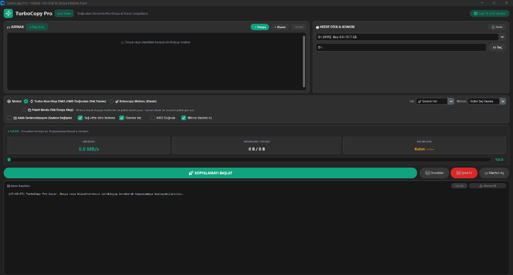

# ⚡ TurboCopy Pro

[](https://www.python.org/)
[](https://microsoft.com/windows)
[](https://opensource.org/licenses/MIT)
[](https://github.com/TomSchimansky/CustomTkinter)

<p align="center">
  
</p>

**TurboCopy Pro**, Windows'un standart kopyalama sisteminin (`explorer.exe`) büyük dosyalarda veya yüz binlerce küçük dosyada (HDD, harici USB diskler ve bölünmüş bölümler arasında) yaşadığı yavaşlık, kilitlenme ve önbellek tıkanması (RAM dirty-page stall) sorunlarını donanım seviyesinde çözen **yüksek hızlı ve modern dosya aktarım aracıdır**.

---

## 🚀 Neden TurboCopy Pro? (Windows Kopyalamasından Farkları)

| Özellik | Windows Standart Kopyalama | TurboCopy Pro |
| :--- | :--- | :--- |
| **Büyük Dosya Aktarımı** | RAM dolunca 10-15 sn donar ("Bir durur bir ilerler") | **Doğrudan DMA (`FILE_FLAG_NO_BUFFERING`): Sıfır donma, kesintisiz 140+ MB/s** |
| **Yüz Binlerce Küçük Dosya (`node_modules`)** | Saatlerce sürer, hız KB/s seviyesine çöker | **📦 Paket (TAR) Modu ile tek akışta 120+ MB/s veya Paralel Burst** |
| **Mekanik Disk (HDD) Uyumu** | Çoklu yazmada disk kafası çırpınır (Head Thrashing) | **Akıllı G/Ç optimizasyonu: HDD kafa hareketini ardışık tutar** |
| **Duraklat / Devam (Pause/Resume)** | Saniyelerce yanıt vermez | **Milisaniyelik anlık tepki & Görsel bildirim** |
| **Arayüz & Kullanıcı Deneyimi** | Hantal ve donan pencereler | **Modern Koyu Tema + Windows Saat Üstü Mini Yüzen İlerleme Çubuğu** |
| **Windows Entegrasyonu** | Sadece standart | **Tek tıkla Windows Explorer Sağ Tık Menüsü Entegrasyonu** |

---

## 🌟 Öne Çıkan Özellikler

### 1. ⚡ Donanım Seviyesi Turbo Non-Stop DMA Motoru
- `VirtualAlloc` ile ayrılmış bellek sayfaları ve doğrudan Windows Kernel Win32 API (`FILE_FLAG_NO_BUFFERING | FILE_FLAG_SEQUENTIAL_SCAN`) kullanır.
- İşletim sisteminin RAM yazma önbelleğini atlayarak veriyi doğrudan diske DMA ile yazar. 77 GB, 500 GB veya terabaytlarca veri kopyalasanız bile **asla kilitlenmez**.

### 2. 📦 Akıllı Paket (TAR) Modu (Küçük Dosya Kurtarıcısı)
- Web projeleri (`node_modules`), kaynak kod depoları (`.git`) veya oyun veri klasörleri gibi 500.000+ ufak dosyayı kopyalarken disk dosya sistemi işlemlerinde boğulmaz.
- Tüm klasör ağacını hedef diske tek bir ardışık `.tar` akışı olarak yazar (140 MB/s bant genişliği).
- **Çift Yönlü:** Kaynak olarak `.tar` dosyası seçildiğinde otomatik olarak arşivi hedef konuma güvenle geri açar (`Path-Traversal / Zip-Slip` korumalı).

### 3. ⏱️ Saat Üzerinde Mini Yüzen İlerleme Çubuğu (Mini Floating Bar)
- Ana pencereyi simge durumuna küçültseniz bile ekranın sağ alt köşesinde, Windows saatinin hemen üzerinde şık, yarı saydam bir mini ilerleme kartı belirir.
- Anlık hız, kalan süre, aktarılan veri ve dosya adını gösterir.
- Üzerindeki **`⏸ Duraklat`** butonuna bastığınız anda çerçeve kehribar sarısına döner ve işlemi anında duraklatır/devam ettirir.

### 4. 🔄 Akıllı Senkronizasyon (Incremental Sync)
- Yarıda kalan veya periyodik yapılan yedeklemelerde hedefteki mevcut ve değişmemiş dosyaları saniyeler içinde tespit edip atlar. Sadece değişen veya yeni eklenen dosyaları kopyalar.

### 5. 🛠️ Sağ Tık Menüsü Entegrasyonu
- Arayüzdeki tek bir butonla Windows Explorer sağ tık menüsüne eklenir. Herhangi bir dosya veya klasöre sağ tıklayıp **"⚡ TurboCopy ile Kopyala"** diyerek doğrudan başlatabilirsiniz.

### 6. 🔌 Otomatik Güç Eylemleri
- Gece büyük kopyalamalar başlatıldığında işlem bittiğinde:
  - Bilgisayarı Kapat
  - Uyku Moduna Al
  - Ekranı Kilitle
  seçenekleri otomatik olarak devreye girer.

---

## 📦 Kurulum ve Çalıştırma

### Gereksinimler
- Windows 10 veya Windows 11 (64-bit)
- Python 3.10 veya üzeri

### Adımlar

1. Depoyu klonlayın:
```bash
git clone https://github.com/muqo16/TurboCopy-Pro.git
cd TurboCopy-Pro
```

2. Gerekli kütüphaneleri yükleyin:
```bash
pip install -r requirements.txt
```

3. Uygulamayı başlatın:
```bash
python app.py
```

> **İpucu:** `TurboCopy.vbs` veya `TurboCopy.bat` dosyasına çift tıklayarak konsol penceresi açılmadan doğrudan başlatabilirsiniz.

---

## 🏗️ Mimari & Dosya Yapısı

```
TurboCopy-Pro/
├── app.py               # Modern CustomTkinter Grafik Arayüzü & Mini Yüzen Çubuk
├── engine.py            # Win32 DMA, Robocopy, TAR Paket Motoru & Donanım Watchdog
├── context_menu.py      # Windows Registry (HKCU) Sağ Tık Menüsü Yöneticisi
├── icon.ico             # Uygulama simgesi
├── TurboCopy.bat        # Hızlı başlatıcı batch dosyası
├── TurboCopy.vbs        # Sessiz başlatıcı VBScript
├── create_shortcut.vbs  # Masaüstü kısayolu oluşturucu
├── requirements.txt     # Python bağımlılıkları
├── LICENSE              # MIT Lisansı
└── README.md            # Dokümantasyon
```

---

## 🛡️ Lisans

Bu proje [MIT Lisansı](LICENSE) kapsamında lisanslanmıştır.  
Geliştirici: [Muzaffer Ulusoy (muqo16)](https://github.com/muqo16)
